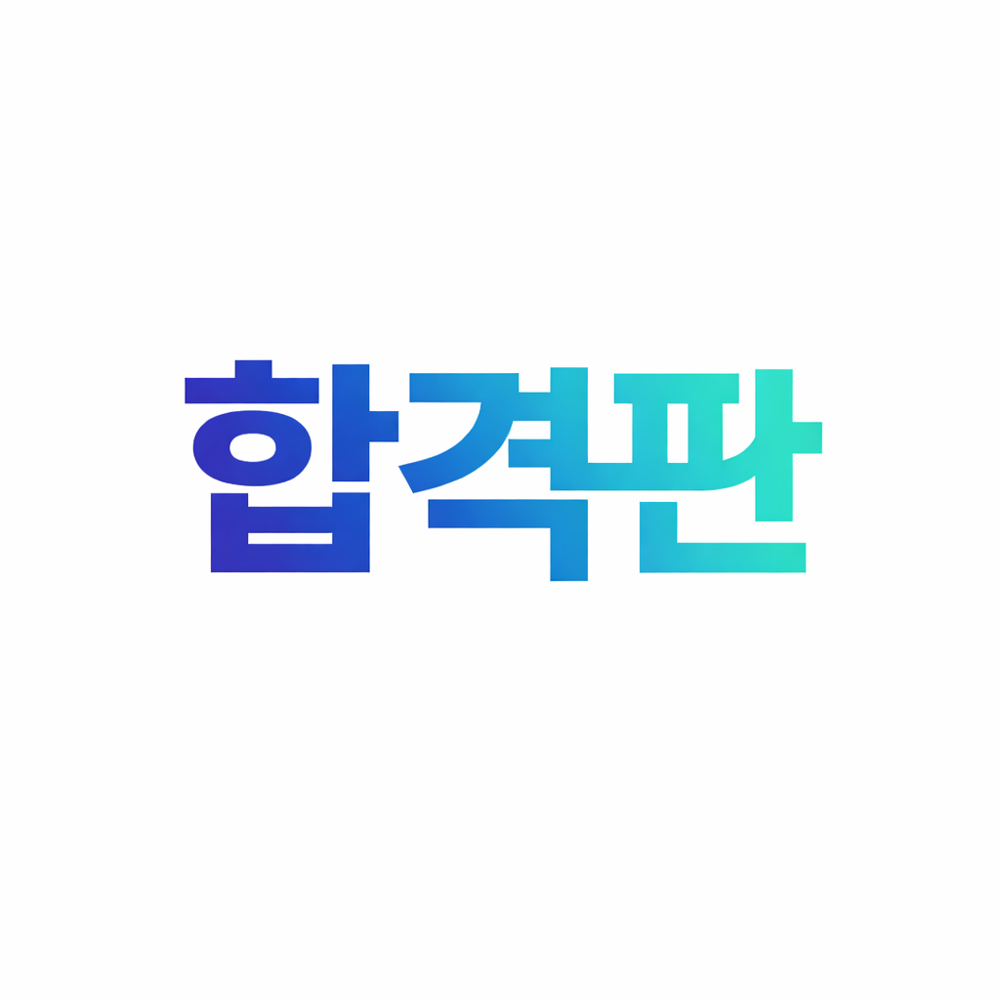
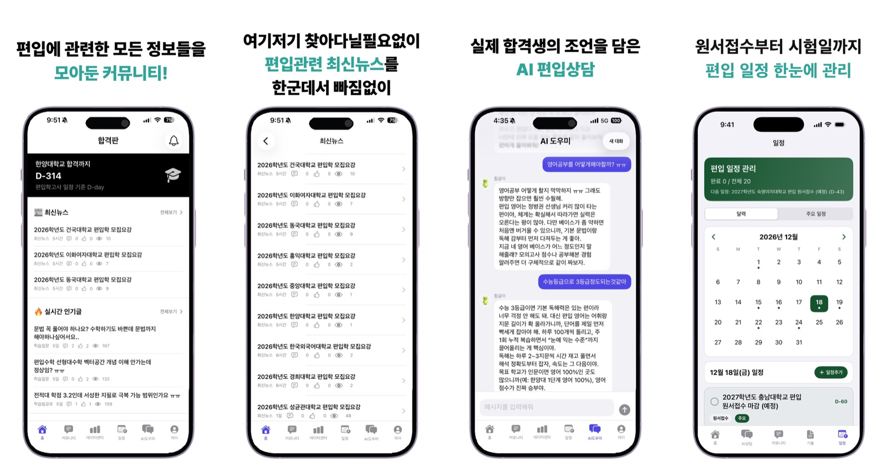
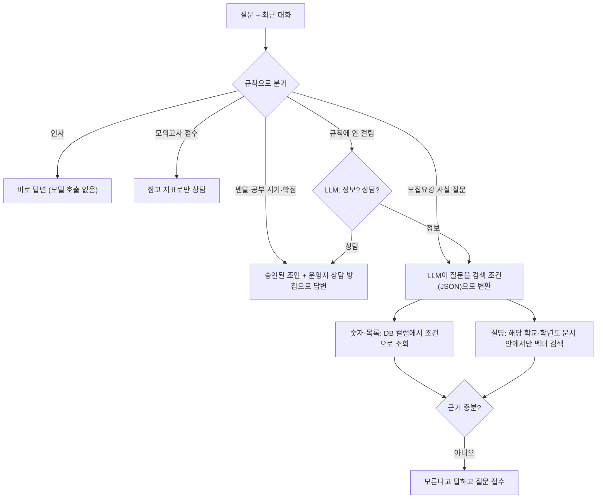

<div align="center">
  

  <h3>공식 모집요강을 근거로만 답하는 편입 정보 · AI 상담 서비스</h3>
  <p>편입 정보 허브 · 모집요강 기반 AI 상담 · 익명 커뮤니티 · Web / iOS</p>

  
  
  
  
  
  
</div>

---

## 소개

편입 정보는 네이버 카페, 커뮤니티, 학원에 흩어져 있고, 일반 LLM에 물으면 해마다 바뀌는 모집요강을 그럴듯하게 지어냅니다. 합격판은 대학별 공지·일정·모집요강을 한곳에 모으고, AI 상담이 **근거가 있을 때만, 근거만큼만** 답하도록 만든 서비스입니다.

기획부터 웹·iOS 개발, App Store 출시, 운영까지 1인으로 진행하고 있습니다.



## AI 상담 구조

모든 질문을 하나의 RAG에 넣지 않고, 질문 종류에 따라 쓰는 자료와 답하는 방식을 나눕니다. 분명한 질문은 규칙이 바로 나누고, 규칙에 걸리지 않은 질문만 LLM이 "정보 질문인지, 상담인지" 한 번 더 판단합니다.



| 질문 | 실제 답변 (발췌) |
|---|---|
| 요즘 편입 준비가 너무 불안하고 지치는데 어떻게 버티면 좋을까? | 편입 준비하면서 그런 감정 드는 건 너무 당연해! … 평소 루틴을 꾸준히 지켜나가는 게 멘탈 관리의 핵심이야. |
| 미대 뽑는 학교 알려줘 | 현재 확보된 16개교 자료 중 미술·디자인 계열 정보가 있는 곳은 강원대, 부산대, 상명대 … 강원대 — 필기 없음 / 면접 40% + 실기 60% |
| 강원대 수의학과 필기 과목 알려줘 | 일반생물학, 일반화학 2과목이야. … 2단계에서 공인영어 30%와 필기고사 70%를 반영해. ※ 2027학년도 기본계획(안) 기준 |
| 이 어플에 강원대학교 있어? | 강원대학교 자료 있어요. 2027학년도 편입학 기본계획은 확보해 두었고, 아직 최종 모집요강은 나오지 않았어요. |

## 모집요강은 '검색'이 아니라 '조회'로

PDF를 잘라 비슷한 문단을 찾는 방식은 "수학만 보는 학교 전부"처럼 **빠짐없는 목록과 정확한 숫자**가 필요한 질문에 약합니다. 그래서 모집요강을 사람이 검수해 전형 규칙 단위로 DB에 저장하고, 숫자와 목록은 DB 값 그대로 답합니다. LLM은 질문을 검색 조건으로 바꾸는 일과 문장형 내용을 설명하는 일만 합니다.

**예시: "수학만 보는 학교 알려줘"**

1. 저장 — 전형 규칙마다 필기 과목·반영비율·배수와 근거 PDF 페이지를 보존합니다.

| 학교 | 모집단위 | 필기 과목 | 최종 필기 / 서류 / 면접 | 출처 |
|---|---|---|---|---|
| 숙명여자대학교 | 화학과·수학과·통계학과 등 | 수학 | 80 / 20 / 0 | p.1 |
| 중앙대학교 | 수학(가) 지정 모집단위 | 수학 | 60 / 40 / 0 | p.4–5 |
| 서울시립대학교 | 화학공학과·기계정보공학과 등 | 수학 | 60 / 35 / 0 (+전적대 5) | p.2–3, 6 |
| 연세대학교 (비교) | 컴퓨터과학과 | 수학, 물리 | 60 / 40 / – | p.3, 5 |

2. 해석 — LLM은 답을 쓰지 않고 strict JSON schema로 검색 조건만 만듭니다.

```json
{ "operation": "list", "factKind": "selection", "admissionYear": 2027, "subjectMode": "math_only" }
```

3. 답변 — 21개교 전형 규칙 126개 중 필기 과목이 수학뿐인 10개(5개교)를 모두 가져와, PDF 페이지와 "현재 21개교 기준"이라는 범위를 함께 답합니다. 수학·물리를 보는 연세대는 빠집니다.

그 밖에 함께 처리하는 것:

- **문서 버전** — 기본계획 → 최종 모집요강 순으로 더 확정된 문서가 들어오면 이전 문서는 자동으로 뒤로 밀립니다.
- **학교별 검색** — 여러 학교를 물으면 학교마다 따로 검색해 한 학교 문단이 결과를 독차지하지 않게 합니다.
- **답하지 않는 것** — 실제 합격자 수·경쟁률·합격선처럼 모집요강에 없는 숫자는 답하지 않습니다.

## 실패에서 고친 것

AI가 "근거가 없다"고 끝낸 실제 질문을 다시 읽고, 원인별로 고쳤습니다.

| 사용자 질문 | 원인 | 조치 |
|---|---|---|
| ㅎㅇ | 인사도 자료 검색을 거쳐 "근거 없음" | 분명한 인사는 바로 답하고, 뒤에 질문이 붙으면 가로채지 않음 |
| 수학 100%에 전적대 성적 안 보는 대학 | "전적대"를 학교 이름으로 인식 | 학교가 아닌 단어 제외 + 필기 100% 조건 검색, 없으면 필기 비중 순 대안 |
| F학점 있으면 인서울 가능? | 상담 질문을 자료 검색으로 보냄 | 학점 상담 방침 추가, 규칙에 안 걸리는 질문은 LLM이 한 번 더 분류 |
| 한양대는? | 앞 대화의 조건을 잇지 못함 | 최근 대화 4턴을 검색 조건 생성에 함께 넣음 |
| 연세대 수물합 140점이면 합격? | 믿을 만한 합격선 데이터 없음 | **일부러 답하지 않음** — 근거 없는 합격 판정이 더 위험하다고 판단 |

같은 이유로 2026년 4월에는 AI 커트라인 분석 기능을 삭제했습니다. 공식 커트라인을 공개하는 학교가 적고, 학원 자료도 복원 정답·추정 점수라 검증할 방법이 없었습니다.

## 측정으로 바꾼 것

**유사도 문턱 0.7 → 0.5** — 지식을 넣어도 "모른다"는 답이 계속 나와, 저장된 질문을 그대로 검색해 보니 5개 중 1개만 통과했습니다. `text-embedding-3` 계열은 이전 모델보다 유사도가 낮게 분포하는데 문턱은 예전 기준이었습니다.

| 시나리오 | 최고 유사도 | 0.70 | 0.50 |
|---|---|---|---|
| 저장된 질문 원문 | 0.598 ~ 0.782 | 1/5 | 5/5 |
| 표현만 바꾼 질문 | 0.530 ~ 0.730 | 1/5 | 5/5 |
| 무관한 문서 | 0.35 ~ 0.51 | — | 대부분 차단 |

**쿼리 분해** — "학점 3.69인데 연세대~홍익대 기계공학과 방향 잡아줘" 같은 복합 질문은 주제가 한 벡터에 뭉개져 검색에 실패했습니다. 80자 이상 질문은 하위 질문 2~4개로 나눠 병렬 검색하고, 같은 질문의 근거가 0개에서 6개로 늘었습니다.

**분류기 응답 잘림** — Gemini를 쓰던 시기, 분류기 JSON이 `{"route`에서 끊겨 항상 예비 로직으로 동작했습니다. thinking 토큰이 출력 예산(120)을 먼저 써버린 것이 원인이라, 짧은 유틸리티 호출에서는 thinking을 끄도록 고쳤습니다.

## 개선 타임라인

| 시기 | 바꾼 것 |
|---|---|
| 2026.02 | 답변 캐시(지식 버전으로 자동 무효화), 단계별 소요시간 기록, 회귀 평가, SSE 스트리밍 |
| 2026.04 | AI 커트라인 분석 기능 삭제 |
| 2026.07 | 유사도 문턱 실측 후 조정, 쿼리 분해 |
| 2026.08 | 모집요강을 DB로 구조화해 조회하는 구조로 전환, 정답·거절 평가 세트 |
| 2026.09 | 모의고사 통계를 합격 판정 근거에서 분리, 대화 맥락으로 후속 질문 처리 |
| 2026.10 | 학교별 검색으로 옆 학과 오답 제거, 의도 분류를 규칙 + LLM 보조로 변경, 실사용 실패 질문 수정, 익명 커뮤니티 재개 |

## 기술 스택

| 영역 | 기술 |
|---|---|
| Web | Next.js 16 (App Router), React 19, TypeScript, Tailwind CSS |
| iOS | Swift / SwiftUI |
| Backend | Next.js Route Handlers, Supabase (PostgreSQL · Auth · Storage · RLS) |
| AI | OpenAI Responses API (Structured Outputs), text-embedding-3-small + pgvector |
| 운영 | 응답 로그·관측 지표, 답변 캐시, 오프라인 평가 스크립트 |

## 프로젝트 구조

```
├── web/
│   ├── app/api/ai/chat/route.ts       # 질문 분기 → 조회/검색 → 답변 생성 (SSE)
│   ├── lib/chatRoutingPolicy.ts       # 인사·모집요강 질문 판별 규칙
│   ├── lib/transferAdmissionCatalog.ts# 모집요강 검색 조건 생성, DB 조회, 학교별 검색
│   ├── lib/transferDocumentPolicy.ts  # 기본계획/최종 모집요강 문서 우선순위
│   ├── lib/*Coaching.ts               # 학점·시작 시기·모의고사 상담 방침
│   ├── lib/aiRag.ts                   # LLM·임베딩 클라이언트
│   ├── lib/aiChatCache.ts             # 지식 버전 기반 답변 캐시
│   └── scripts/                       # 모집요강 적재·일정 동기화·평가
├── ios/HapgyeokpanApp/                # SwiftUI 앱 (웹과 같은 API 사용)
└── docs/knowledge-extractions/        # 학교별 검수된 모집요강 데이터
```
